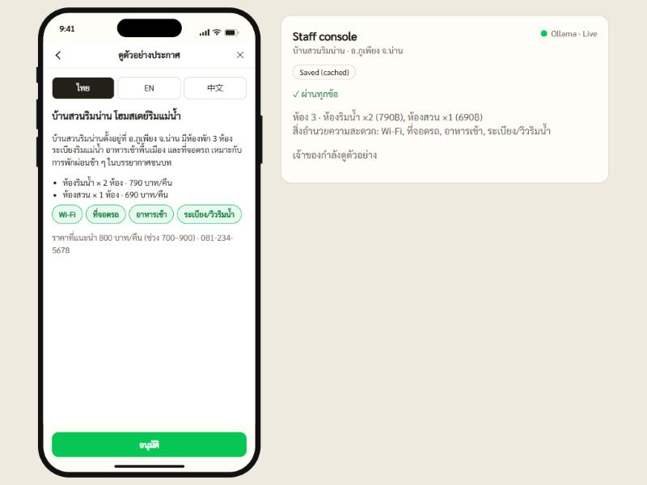

<div align="center">

# เปิดบ้าน · Poet Baan

### AI helps rural homestays get listed on Agoda — in Thai, English & Chinese

Homestay owners fill a short guided form inside LINE. AI writes their listing in three
languages, automated checks run, the owner approves a preview, and an AI coach walks them
through the sign-up for **Agoda** and **Google Maps** until the listing is live.
**We take no bookings, no payments and no commission** (free until the first guest, then a
monthly plan; billing is simulated in this demo).




## [⬇️ &nbsp; Download the demo](https://github.com/salapa0/PerdBaan_Ai/archive/refs/heads/main.zip)

**[Quick start](#-quick-start)** · **[Turn on the live AI](#-turn-on-the-live-ai-optional)** · **[Demo flow](#-demo-flow-about-3-minutes)** · **[Docs](#-docs)**

</div>

---

## ✨ What it does

- 📝 **Guided form in LINE** — the owner picks the number of rooms, room types, prices, amenities and photos on their phone; no typing a listing from scratch.
- 🌏 **AI writes the listing in 3 languages** — Thai, English and Chinese. The owner previews each language (with the photo gallery and a suggested price range) and approves it.
- ✅ **Automated checks in the staff console** — the console shows whether the draft is **Live AI** or **Saved (cached)**, the check results (price, phone, banned claims, photos), and each channel's progress. The owner is the only approver.
- 🤝 **AI sign-up coach for two channels** — **Agoda** (bookings) and **Google Maps** (discovery). It walks the owner through sign-up with tap-to-copy cards, shows their form photos on the photos step, and reads a screenshot to point at the right card.
- 💬 **LINE-style chat** — rich-menu tiles for filling the form, previewing, connections, asking about Agoda, finance and help; a live announcement card appears in the chat when a channel goes live.
- 💵 **Finance page (simulated)** — free until the first guest enquiry, then the ฿490/month Standard plan is shown. No commission is taken by เปิดบ้าน.
- 🔌 **Offline by design** — runs fully on one laptop. Works even with no AI installed: every AI step falls back to a saved answer.

---

## 🖥️ Requirements

You install just **two things** — the demo, and (optionally) the local AI. Everything else is built in.

| For | You need | Where to get it |
| --- | --- | --- |
| The demo (required) | Python 3 | https://www.python.org/downloads/ — tick **Add Python to PATH** during install |
| Live AI (optional) | Ollama + about 11 GB free RAM | https://ollama.com |

Without the live AI the demo still runs end to end: the AI mode starts as **Live**, and if Ollama is not running every AI step quietly uses a saved answer. The staff console shows **Live AI** or **Saved (cached)** for each result.

The app keeps its state in memory only, so reloading the page starts from the beginning.

---

## 🚀 Quick start

**1. Get the demo** — click **[⬇️ Download the demo](https://github.com/salapa0/PerdBaan_Ai/archive/refs/heads/main.zip)** and unzip it (or `git clone https://github.com/salapa0/PerdBaan_Ai.git`).

**2. Run it** — double-click **`start-demo.bat`** (Windows). It starts the local server and opens Chrome at **http://localhost:5173**.

On Mac / Linux, run this from the project folder, then open **http://localhost:5173** in Chrome:

```
python3 -m http.server 5173
```

> Don't double-click `index.html` — the app needs the local server to load its files.

That's it; the demo is fully usable now. The next step is optional.

---

## 🤖 Turn on the live AI (optional)

Do this only if you want to watch the AI generate live instead of using saved answers. (The default mode is **Live**; with Ollama off, the app falls back to saved answers by itself. Press **Shift+S** to force Saved mode.)

1. Install Ollama from https://ollama.com and start it.
2. Run **`setup-ollama.bat`**. It lets the page talk to Ollama (`OLLAMA_ORIGINS`) and downloads the two models below (several GB — do this ahead of time).
3. Quit Ollama from the tray, start it again, then reload the page. The console's **Ollama** light turns green.

| Model | Job | Tag |
| --- | --- | --- |
| Typhoon 8B (SCB 10X) | Thai + English listing | `hf.co/scb10x/llama-3-typhoon-v1.5-8b-instruct-gguf` |
| Qwen2.5-VL 7B | Chinese translation, reading Agoda screenshots | `qwen2.5vl:7b` (use `:3b` if it feels slow) |

The default tags are already set in `src/config.js`, so there's nothing to edit unless you pull a different size (e.g. `:3b`). Together the models need about 11 GB of RAM.

---

## 🎬 Demo flow (about 3 minutes)

1. **Shift+R** to reset. Tap **เริ่มเลย** in the chat (or the **กรอกข้อมูล** tile in the menu grid at the bottom). Every page has a back arrow (top left) and a ✕ that returns to the chat.
2. **Shift+L** loads the demo homestay (3 rooms, 2 room types, amenities and 6 photos). Tap **ให้ AI เขียนประกาศ**.
3. The draft goes straight to the owner's phone as a preview; there is no staff approval step. In the staff console, point at the **Live AI / Saved (cached)** tag and the check results.
4. On the phone: switch ไทย / English / 中文, then tap **อนุมัติ**. The chat offers **ไปที่หน้าการเชื่อมต่อ**.
5. On the connections page, tap **เชื่อมต่อ** on **Agoda** (or **Google Business Profile**) and follow the coach. Step 4 is the photos page, showing the photos from the form. At the last step, send a screenshot: the AI explains the page in Thai and highlights which card to copy.
6. Paste a sample link (Agoda: `https://www.agoda.com/baan-suan-rim-nan/hotel/nan-th.html`, Google: `https://maps.app.goo.gl/baan-suan-rim-nan`), tap **ส่งลิงก์**, then **Shift+A** to show that channel going live: its own announcement card (cover photo, name, link) appears in the chat at once. Do the other channel and it gets its own card.
7. **Shift+C** simulates a guest enquiry; the chat shows the message and a **การเงิน** (finance) page with the running summary.

<details>
<summary><b>Presenter shortcuts</b></summary>

**Shift+D** shows a hidden toolbar with the same controls. Shortcuts are ignored while typing in a field.

| Key | Action |
| --- | --- |
| Shift+L | Load demo homestay |
| Shift+S | Switch AI mode Live / Saved |
| Shift+F | Stop the running AI call and use the saved answer |
| Shift+W | Warm up both models (do this ~5 minutes before presenting) |
| Shift+A | Simulate approval of the channel being connected (Agoda or Google): it goes live |
| Shift+C | Simulate a guest enquiry (starts the finance summary) |
| Shift+1 … 7 | Jump to a saved point: 1 chat · 2 form · 3 chat with draft ready · 4 preview · 5 connections · 6 coach · 7 live |
| Shift+B | Back one page |
| Shift+R | Reset everything |

</details>

---

## 🧩 What is simulated

Agoda and Google themselves (the coach draws simplified placeholder sign-up pages and a "simulate approval" key stands in for their checks; the real sites are never automated), guest enquiries and the finance numbers (sample guests, estimated income, the ฿490/month plan; no real payment), the help page's hours and hotline number (sample data), the map pin (a hint card only), and LINE itself (the phone is a web page styled like LINE). Not built: real LINE Official Account integration, servers, logins, real booking alerts, real billing, saving state between page reloads.

---

## 📚 Docs

- [Project baseline](docs/project-baseline.md): the whole project in one place
- [Demo MVP scope](docs/demo-mvp-scope-local.md): what is built, faked and left out
- [Prototype build spec](docs/prototype-build-spec.md): stack and build details
- [Known issues](docs/known-issues.md): open problems and clean-up to do

---

<details>
<summary><b>🛠️ For contributors & maintainers</b></summary>

### Project layout

| Path | What it is |
| --- | --- |
| `index.html` | The page: phone (left) and staff console (right) |
| `src/app.js` | Starts the app: wires clicks and typing, scales the phone, checks Ollama |
| `src/state.js`, `src/actions.js`, `src/router.js`, `src/toolbar.js`, `src/config.js`, `src/photos.js` | App state (in memory), everything a button can do, drawing the phone, presenter toolbar, settings, shrinking photos |
| `src/ui/` | `app.css` (all styles) and `dom.js` (small helpers) |
| `src/screens/owner.js` | All of the owner's screens: chat with the rich menu, form, writing, preview, connections, coach, finance, help |
| `src/console/` | The staff console |
| `src/ai/` | Talking to the local AI, with a fallback for every call |
| `src/rules/` | Fixed checks and builders (no AI): listing checks, price, copy cards, link check |
| `src/data/` | Demo homestay, saved AI answer, channels (`platforms.js`), form choices, preview text in 3 languages |
| `public/` | Files the app loads: fonts and demo photos (`public/agoda/` is only used by the older screens, see below) |
| `content/` | Working material the app does not load: real screenshots, pitch |
| `docs/` | Decisions and specs |
| `test.html` | Logic self-tests: open http://localhost:5173/test.html |

**Older files still in the repo.** Some files are no longer loaded by the app (an earlier set of separate screens and a second AI pipeline). They are listed in [src/README.md](src/README.md) and [docs/known-issues.md](docs/known-issues.md); check there before editing a file in `src/screens/`, `src/ui/` or `src/ai/`.

### Saving your work

See [CONTRIBUTING.md](CONTRIBUTING.md) for the GitHub Desktop flow, handling conflicts, and what not to commit.

### Before demo day

- [ ] Regenerate `src/data/savedDraft.js` with the real local models (best of 3 runs, fix any Thai / Chinese errors).
- [ ] Swap the illustrated demo photos in `public/demo-photos/` for real ones (same file names, under 500 KB each).
- [ ] Take a fresh screenshot for `docs/images/hero.jpg`: the current one shows an older version of the preview page.
- [ ] Replace the sample hotline and hours on the help page (`helpHtml()` in `src/screens/owner.js`) if you show it to judges.
- [ ] Real Agoda / Google screenshots: the coach currently draws simplified placeholder pages and does not read `public/agoda/`. Showing real screenshots needs a code change in `src/screens/owner.js`.
- [ ] Run the full demo once with Wi-Fi off, and record a backup video.

</details>
